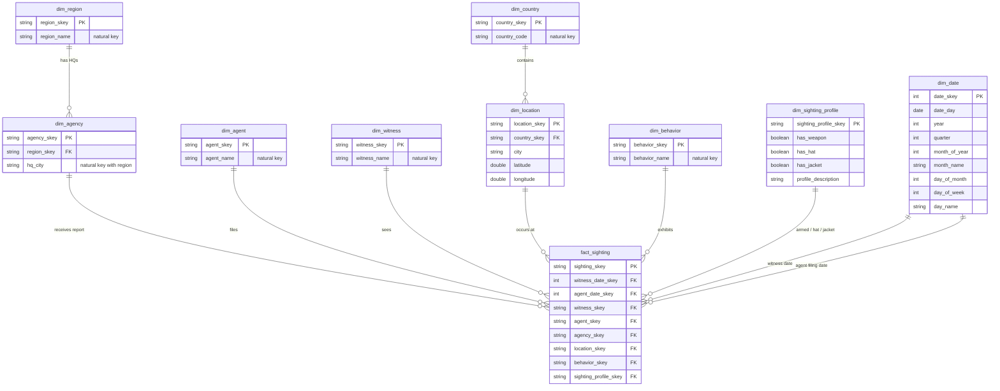

# Where in the World is Carmen Sandiego? — a dbt + DuckDB solution

Interpol's eight regional agencies file their field reports in Excel, each with its own column names, one of them
in Chinese. This project turns that workbook into a clean, normalised warehouse and uses it to answer four questions about
Ms. Sandiego.

| | |
|---|---|
| **Database** | **DuckDB** (a single local file, `dbt/wheres-carmen.duckdb`) |
| **Transformation** | dbt (developed and run on **dbt v2**, which ships the DuckDB adapter) + the `dbt_utils` package |
| **Source** | `achilala-repo/carmen_sightings/carmen_sightings_20220629061307.xlsx` — 8 sheets, **13,582** field reports, witnessed 1985-04-23 → 2022-06-29 |
| **Result of `dbt build`** | 8 seeds · 9 staging/intermediate views · 10 warehouse tables · 5 analytics views · **194 data tests — all 226 steps pass** |

---

## Contents

1. [The answers at a glance](#1-the-answers-at-a-glance)
2. [How to run it](#2-how-to-run-it)
3. [Architecture and repository layout](#3-architecture-and-repository-layout)
4. [Step 1 — Extract the workbook into seeds](#4-step-1--extract-the-workbook-into-seeds)
5. [Step 2 — One staging view per source, mapped to the common data dictionary](#5-step-2--one-staging-view-per-source-mapped-to-the-common-data-dictionary)
6. [Step 3 — A normalised warehouse schema (beyond 1NF)](#6-step-3--a-normalised-warehouse-schema-beyond-1nf)
7. [Step 4 — Analytical views and the four answers](#7-step-4--analytical-views-and-the-four-answers)
8. [Testing](#8-testing)
9. [Documentation (`dbt docs`)](#9-documentation-dbt-docs)
10. [Assumptions, limitations and design trade-offs](#10-assumptions-limitations-and-design-trade-offs)

---

## 1. The answers at a glance

"Each month" means **calendar month (January–December) with all years pooled**, assigned by the date the witness saw her.
Probabilities are empirical relative frequencies (matching reports ÷ all reports in that month). Full detail in [section 7](#7-step-4--analytical-views-and-the-four-answers).

| Question | Answer |
|---|---|
| **a.** Most likely agency region per month | **Europe** in Feb, May, Aug, Sep, Oct, Nov · **America** in Jan, Mar, Apr, Jul · **Asia** in Jun, Dec. Europe, America and Asia are close in every month (each ~26–34%); only August and September have a clear winner. |
| **b.** P(armed ∧ jacket ∧ ¬hat) | **3.92%** overall (533 of 13,582), ranging from 2.4% (Nov) to 4.7% (Jun). She is rarely armed (11.4%), almost always wears a jacket (92.5%) and wears a hat about 63% of the time. The three traits behave independently, and the monthly swings are not statistically significant. |
| **c.** Three most frequent behaviors | **out-of-control** (637), **complaining** (636), **happy** (635) — but with 23 behaviors the counts are statistically indistinguishable from uniform. |
| **d.** P(one of the top-3 behaviors) per month | **12.1%–15.3%** by month, **14.05%** overall (1,908 / 13,582), versus 13.04% (3/23) if all behaviors were equally likely. No month stands out. |

> **The honest headline:** the data contains almost no month-to-month signal. The "winners" in (a) and (c) are
> real counts but narrow ones, and should not be read as seasonal habits of Ms. Sandiego.

---

## 2. How to run it

### Prerequisites
- Python 3.10+ (only to regenerate the seeds)
- [dbt v2](https://docs.getdbt.com/docs/local/install-dbt) — the DuckDB adapter is built in
- Optional: the [DuckDB CLI](https://duckdb.org/docs/installation/) (`winget install DuckDB.cli` on Windows) to query the result

### Steps
```bash
# 1. (optional) regenerate the seeds from the Excel workbook.
#    The script uses relative paths, so run it FROM the scripts/ folder.
python -m venv .venv
.venv\Scripts\Activate.ps1          # Windows PowerShell   (macOS/Linux: source .venv/bin/activate)
pip install -r requirements.txt     # pandas, openpyxl
cd scripts
python export_xl_sheets_to_seeds.py
cd ..

# 2. build everything: seeds -> staging -> intermediate -> warehouse -> analytics (+ all tests)
cd dbt
dbt deps          # installs dbt_utils
dbt build
```

A successful run ends with `PASS=226 WARN=0 ERROR=0`.

### Query the result
```bash
duckdb dbt/wheres-carmen.duckdb
```
```sql
select * from analytics.ana_a_most_likely_region_by_month;
select * from analytics.ana_b_armed_jacket_no_hat_by_month;
select * from analytics.ana_c_top3_behaviors;
select * from analytics.ana_d_top3_behavior_probability_by_month;
```
Or without installing anything extra: `dbt show --inline "select * from analytics.ana_c_top3_behaviors"`
(DuckDB allows one writer at a time, so close any viewer attached to the file — or open it read-only — before running `dbt build`.)

### Schemas created in the database

| Schema | Contents | Materialisation |
|---|---|---|
| `raw` | the 8 seeds, one per workbook sheet | tables |
| `staging` | `stg_<region>` × 8 — each source mapped to the common data dictionary | views |
| `intermediate` | `int_unioned` — the eight sources stacked | view |
| `warehouse` | the normalised model: 9 dimensions + `fact_sighting` | **tables** |
| `analytics` | `ana_a_…` to `ana_d_…` — the four answers | views |

The macro `dbt/macros/generate_schema_name.sql` makes dbt use these schema names exactly as configured. Without it dbt prefixes
the target schema (`main_raw`, `raw_raw`, …).

---

## 3. Architecture and repository layout


```
.
├── README.md
├── requirements.txt                       pandas, openpyxl
├── achilala-repo/                         the assessment repo (workbook lives here)
│   └── carmen_sightings/carmen_sightings_20220629061307.xlsx
├── scripts/
│   └── export_xl_sheets_to_seeds.py       Step 1: Excel sheets -> CSV seeds
├── docs/images/                           dbt docs screenshots used below
└── dbt/
    ├── dbt_project.yml  profiles.yml  packages.yml
    ├── macros/generate_schema_name.sql
    ├── seeds/                             africa.csv … pacific.csv (8 files)
    └── models/
        ├── staging/        stg_<region>.sql × 8, _staging.yml
        ├── intermediate/   int_unioned.sql, int_unioned.yml
        ├── marts/          dim_*.sql × 9, fact_sighting.sql, schema.yml      (schema: warehouse)
        └── analytics/      ana_a_* … ana_d_*, schema.yml
```

---

## 4. Step 1 — Extract the workbook into seeds

`scripts/export_xl_sheets_to_seeds.py` reads **every** sheet in one call and writes one CSV per sheet into `dbt/seeds/`:

```python
sheets = pd.read_excel(WORKBOOK, sheet_name=None,   # None -> {sheet name: DataFrame} for all sheets
                       dtype=str,                   # keep everything as text; dbt casts types later
                       keep_default_na=False)       # don't turn "NA" or empty cells into NaN
for sheet_name, df in sheets.items():
    df.to_csv(SEEDS / f"{sheet_name.lower()}.csv",
              index=False,                          # no pandas index column in the seed
              encoding="utf-8")                     # keeps the Chinese headers in ASIA intact
```

Design choices:
- **Everything is read as text.** The seeds are then an untouched copy of the Excel data; typing (dates, floats, booleans) is the staging layer's job, where it is visible and testable. It also stops pandas from "helpfully" turning dates into timestamps or flags into floats.
- **`index=False`** — otherwise each CSV would gain an unnamed first column of row numbers (14 columns instead of 13).
- **`utf-8`** — the ASIA sheet has headers `报道`, `纬度`, `经度`.
- **`+quote_columns: true`** in `dbt_project.yml` lets dbt quote those non-ASCII and punctuated headers (`armed?`, `chapeau?`, `coat?`) when loading.
- Seed names are the lower-cased sheet names, so `ref('europe')`, `ref('asia')`, … are what staging reads.

### What the workbook contains

| Sheet (region) | Reports | Notes |
|---|---:|---|
| EUROPE | 4,199 | punctuated headers: `armed?`, `chapeau?`, `coat?`, `lat_`, `long_`, `observed_action` |
| AMERICA | 4,021 | already on dictionary names (except `region_hq`) |
| ASIA | 3,835 | mixed English/**Chinese** headers: `报道`, `纬度`, `经度`, `citizen`, `officer`, `nation` |
| AFRICA | 1,192 | already on dictionary names (except `region_hq`) |
| AUSTRALIA | 165 | bespoke names: `witnessed`, `reported`, `observer`, `field_chap`, `place`, `interpol_spot`, `state_of_mind` |
| INDIAN | 76 | already on dictionary names (except `region_hq`) |
| PACIFIC | 66 | bespoke names: `sight_on`, `file_on`, `sighter`, `filer`, `town`, `report_office` |
| ATLANTIC | 28 | already on dictionary names (except `region_hq`) |
| **Total** | **13,582** | the sum of the eight seeds equals `int_unioned` and `fact_sighting` — no report is lost or duplicated |

### Data profiling (done before modelling)
- **No empty cells and no duplicate rows** in any sheet.
- Boolean flags are always exactly `True` / `False`.
- Dates are ISO text (`YYYY-MM-DD`) and **all parse**; no report was filed before it was witnessed. Filing lag is 0–59 days (mean 29.4).
- Coordinates are in valid ranges (latitude −54.8 … 68.8, longitude −156.5 … 178.0).
- **23 distinct behaviors**, all lower-case with no spelling or whitespace variants (smaller sheets show fewer: ATLANTIC 17, PACIFIC 21, INDIAN 22).
- 181 distinct agency HQ cities, 134 country codes, 958 distinct sighting locations.

Because the data is this clean, the staging layer needs only renaming and typing — no cleaning rules.

---

## 5. Step 2 — One staging view per source, mapped to the common data dictionary

Each `stg_<region>` view selects from its seed, renames columns to the common data dictionary, casts to the right type, and adds a literal
`region` column recording which sheet the row came from. All are views, as the brief requires.

| Dictionary column | Type | EUROPE | ASIA | AUSTRALIA | PACIFIC | AFRICA / AMERICA / ATLANTIC / INDIAN |
|---|---|---|---|---|---|---|
| `date_witness` | date | `date_witness` | `sighting` | `witnessed` | `sight_on` | `date_witness` |
| `witness` | string | `witness` | `citizen` | `observer` | `sighter` | `witness` |
| `agent` | string | `agent` | `officer` | `field_chap` | `filer` | `agent` |
| `date_agent` | date | `date_filed` | `报道` | `reported` | `file_on` | `date_agent` |
| `city_agent` | string | `region_hq` | `city_interpol` | `interpol_spot` | `report_office` | `region_hq` |
| `country` | string | `country` | `nation` | `nation` | `nation` | `country` |
| `city` | string | `city` | `city` | `place` | `town` | `city` |
| `latitude` | float | `lat_` | `纬度` | `lat` | `lat` | `latitude` |
| `longitude` | float | `long_` | `经度` | `long` | `long` | `longitude` |
| `has_weapon` | boolean | `armed?` | `has_weapon` | `has_weapon` | `has_weapon` | `has_weapon` |
| `has_hat` | boolean | `chapeau?` | `has_hat` | `has_hat` | `has_hat` | `has_hat` |
| `has_jacket` | boolean | `coat?` | `has_jacket` | `has_jacket` | `has_jacket` | `has_jacket` |
| `behavior` | string | `observed_action` | `behavior` | `state_of_mind` | `behavior` | `behavior` |


Types: `date` → `cast(… as date)`, `float` → `cast(… as double)` (DuckDB's float type), booleans → `cast(… as boolean)`, strings pass through.

Every staging model follows the same pattern — a `src` CTE, then a `final` CTE — so a reviewer can diff any two and see only the column mapping:

```sql
with src as (select * from {{ ref('asia') }})

,final as (
    select
        'ASIA'                          as region,
        cast(sighting as date)          as date_witness,
        citizen                         as witness,
        officer                         as agent,
        cast("报道" as date)             as date_agent,
        city_interpol                   as city_agent,
        nation                          as country,
        city                            as city,
        cast("纬度" as double)           as latitude,
        cast("经度" as double)           as longitude,
        cast(has_weapon as boolean)     as has_weapon,
        cast(has_hat as boolean)        as has_hat,
        cast(has_jacket as boolean)     as has_jacket,
        behavior                        as behavior
    from src
)

select * from final
```

All eight views are described and tested in `dbt/models/staging/_staging.yml`. The 13 dictionary columns are defined **once** in a YAML anchor
and merged into each model, so the dictionary has a single source of truth (dbt v2 requires such reusable fragments to sit under `anchors:`).
Every column carries a `data_type`, a description taken from the dictionary, and a `not_null` test (104 tests).

### The union: `int_unioned`
`dbt/models/intermediate/int_unioned.sql` stacks the eight views with `union all` and adds `sighting_id`, a surrogate key built with
`dbt_utils.generate_surrogate_key` over **all 14 columns including `region`**, so every report has a stable, deterministic identity.
It is tested `unique` + `not_null`. Because no sheet contains duplicate rows, the key is unique across all 13,582 reports.

---

## 6. Step 3 — A normalised warehouse schema (beyond 1NF)

`int_unioned` is a single wide table that repeats agent, witness, HQ and location details on every row. The warehouse
(`dbt/models/marts/`, schema `warehouse`, persisted as **tables**) is a star-shaped model in which every attribute is stored once, in the table
whose key determines it.

### Entity-relationship diagram



### The tables

| Table | Rows | Grain / purpose |
|---|---:|---|
| `fact_sighting` | 13,582 | one row per field-agent report; **only keys** — no descriptive columns |
| `dim_date` | 13,879 | one row per calendar day, 1985-01-01 → 2022-12-31 |
| `dim_sighting_profile` | 8 | junk dimension: every armed / hat / jacket combination |
| `dim_region` | 8 | the eight Interpol regions (one per sheet) |
| `dim_agency` | 181 | an agency HQ; belongs to exactly one region |
| `dim_agent` | 510 | field agents who file reports |
| `dim_witness` | 12,525 | witnesses |
| `dim_country` | 134 | countries of sighting |
| `dim_location` | 958 | a city + its coordinates, inside a country |
| `dim_behavior` | 23 | distinct behavior descriptions |


### Design decisions
- **Surrogate keys are deterministic hashes** (`dbt_utils.generate_surrogate_key` over the natural key), not row numbers. A rebuild — or a new load order — produces the same keys, so downstream references never drift.
- **`dim_date` is a role-playing dimension.** A report has two dates — when the witness saw her and when the agent filed — and both point at the same `dim_date` (`witness_date_skey`, `agent_date_skey`, integers in `yyyymmdd` form). The calendar covers whole years, and `relationships` tests guarantee no report falls outside it. Month names and numbers come from here instead of being recomputed in each view.
- **`dim_sighting_profile` is a junk dimension.** `has_weapon`, `has_hat` and `has_jacket` are three unrelated yes/no flags. Leaving them on the fact table is clutter; three separate dimensions would be overkill. The 2 × 2 × 2 = **8** combinations live in one tiny table (built as a full cross join, so its keys never change if the data does) and the fact stores one key. All eight profiles occur in the data (52 to 6,984 reports each).
- **Region belongs to the agency, not to the country.** A report’s region is the Interpol region of the agency that received it, which is the workbook sheet it came from. It is not derived from the country where Ms. Sandiego was seen, because four countries are reported through more than one region(US,Spain,Portugal,Russia)
- **Agents and witnesses are identified by name**, the only identifier the reports carry. This is an assumption (see [section 10](#10-assumptions-limitations-and-design-trade-offs)).
- **Facts hold keys only** — descriptive text lives in dimensions, so fixing a typo in a city or agent name is a one-row change.

`fact_sighting` is built by inner-joining `int_unioned` to each dimension on its natural key. The inner joins are safe because every dimension is derived from the same `int_unioned` rows, and the row count is reconciled: 13,582 in = 13,582 out. `dbt test test_fact_rowcount_matches_sources` asserts it.

---

## 7. Step 4 — Analytical views and the four answers

The four questions are answered by views in schema `analytics`, built **only** on `warehouse` tables (never on staging or raw):

| View | Answers |
|---|---|
| `ana_a_region_probability_by_month` | support for (a): sightings per month × region |
| `ana_a_most_likely_region_by_month` | **(a)** |
| `ana_b_armed_jacket_no_hat_by_month` | **(b)** |
| `ana_c_top3_behaviors` | **(c)** |
| `ana_d_top3_behavior_probability_by_month` | **(d)** — reuses (c) so the top-three definition lives in one place |

**Conventions** — *month* is `dim_date.month_of_year` joined on the **witness** date: when she was actually seen, not when the paperwork was filed. All years 1985–2022 are pooled. *Probability* = matching reports ÷ all reports in that month. *Region* is the agency region that received the report.

### a. For each month, which agency region is Carmen most likely to be found in?

**Logic:** count reports per (month, region), then take the top-ranked region in each month with `rank() over (partition by month_num order by sightings desc)`. Using `rank()` rather than `row_number()` means a tie would return every tied region rather than hiding one.

```sql
-- ana_a_region_probability_by_month: fact -> dim_date (month), dim_agency -> dim_region (region)
select d.month_of_year as month_num, d.month_name, r.region_name, count(*) as sightings
from fact_sighting f
  join dim_date d    on d.date_skey    = f.witness_date_skey
  join dim_agency ag on ag.agency_skey = f.agency_skey
  join dim_region r  on r.region_skey  = ag.region_skey
group by 1, 2, 3
```

| month_name | most_likely_region | sightings | month_total | probability |
|---|---|---:|---:|---:|
| January | AMERICA | 341 | 1147 | 0.2972972972972973 |
| February | EUROPE | 331 | 1045 | 0.3167464114832536 |
| March | AMERICA | 352 | 1147 | 0.30688753269398433 |
| April | AMERICA | 340 | 1118 | 0.3041144901610018 |
| May | EUROPE | 358 | 1178 | 0.30390492359932086 |
| June | ASIA | 345 | 1139 | 0.3028972783143108 |
| July | AMERICA | 350 | 1147 | 0.3051438535309503 |
| August | EUROPE | 391 | 1147 | 0.34088927637314737 |
| September | EUROPE | 376 | 1110 | 0.3387387387387387 |
| October | EUROPE | 362 | 1147 | 0.3156059285091543 |
| November | EUROPE | 353 | 1110 | 0.31801801801801804 |
| December | ASIA | 351 | 1147 | 0.3060156931124673 |

**Reading it.** Europe wins 6 months, America 4, Asia 2. Across the whole dataset the three leading regions are Europe, America and Asia.
Overall, the region mix does **not** depend on the month (chi-square on the region × month table: χ² = 71.7, 77 d.f., p = 0.65), so the best single guess for "where is she?" in *any* month is Europe, and by a small margin.
One more caveat: these are shares of **reports**, so they also reflect how much each agency files, not only where she travels.

### b. P(armed AND wearing a jacket AND NOT a hat) per month — and what it tells us

**Logic:** join the fact table to `dim_sighting_profile` and count reports with `has_weapon and has_jacket and not has_hat`, per month, with a conditional aggregate (`count(*) filter (where …)`), and divide by all reports in the month. The view also returns an "All months" row and the marginal probabilities of each trait, which the observations below rely on.

| month_num | month_name | sightings | armed_jacket_no_hat | probability_armed_jacket_no_hat | probability_armed | probability_jacket | probability_no_hat |
|---:|---|---:|---:|---:|---:|---:|---:|
| 1 | January | 1147 | 44 | 0.03836094158674804 | 0.10897994768962511 | 0.9363557105492589 | 0.3757628596338274 |
| 2 | February | 1045 | 35 | 0.03349282296650718 | 0.11674641148325358 | 0.9272727272727272 | 0.35406698564593303 |
| 3 | March | 1147 | 53 | 0.046207497820401046 | 0.11769834350479512 | 0.9250217959895379 | 0.36965998256320837 |
| 4 | April | 1118 | 36 | 0.03220035778175313 | 0.11091234347048301 | 0.9230769230769231 | 0.3685152057245081 |
| 5 | May | 1178 | 41 | 0.03480475382003396 | 0.09932088285229201 | 0.9303904923599321 | 0.37181663837011886 |
| 6 | June | 1139 | 54 | 0.04741000877963126 | 0.13432835820895522 | 0.9139596136962248 | 0.3582089552238806 |
| 7 | July | 1147 | 44 | 0.03836094158674804 | 0.10636442894507411 | 0.9197907585004359 | 0.38099389712292936 |
| 8 | August | 1147 | 50 | 0.043591979075850044 | 0.12031386224934612 | 0.9197907585004359 | 0.36704446381865735 |
| 9 | September | 1110 | 48 | 0.043243243243243246 | 0.12072072072072072 | 0.9207207207207208 | 0.37207207207207205 |
| 10 | October | 1147 | 49 | 0.042720139494333044 | 0.10810810810810811 | 0.9128160418482999 | 0.3958151700087184 |
| 11 | November | 1110 | 27 | 0.024324324324324326 | 0.10540540540540541 | 0.927027027027027 | 0.37657657657657656 |
| 12 | December | 1147 | 52 | 0.045335658238884045 | 0.12292938099389712 | 0.939843068875327 | 0.3748910200523104 |
| NULL | All months | 13582 | 533 | 0.03924311588867619 | 0.11426888528935356 | 0.9246797231630098 | 0.37225739949933734 |


**General observations about Ms. Sandiego**
1. **She is rarely armed** (about 1 in 9).
2. **She almost always wears a jacket** Her usual look is *unarmed, hat, jacket*, followed by *unarmed, no hat, jacket*.
3. **She wears a hat more often than not**
4. **The monthly differences are noise.** The probability moves between 2.4% and 4.7%, but each month has only 27–54 qualifying reports out of ~1,100. November's low and June's high should not be read as a seasonal pattern.
5. **Practical read:** the specific "armed, jacket, no hat" profile is uncommon (about 1 sighting in 25), but not rare enough to be a useful identifier on its own.

### c. The three most frequently observed behaviors

**Logic:** count reports per behavior, rank with `rank() over (order by sightings desc)`, keep rank ≤ 3 (ties at third place would all be kept).

| behavior_name | sightings | share_of_sightings | behavior_rank |
|---|---:|---:|---:|
| out-of-control | 637 | 0.04690030923280813 | 1 |
| complaining | 636 | 0.04682668237372994 | 2 |
| happy | 635 | 0.046753055514651747 | 3 |

The margin is razor-thin. The top three are a correct answer to the question as asked — but they are not meaningfully more characteristic of Ms. Sandiego than the rest.

### d. For each month, the probability she exhibits one of her three most frequent behaviors

**Logic:** left-join each report's behavior to `ana_c_top3_behaviors` and count the matches per month, divided by all reports in that month. Because it reads from view (c), the "top three" is defined in exactly one place.

| month_num | month_name | sightings | top3_behavior_sightings | probability_top3_behavior |
|---:|---|---:|---:|---:|
| 1 | January | 1147 | 160 | 0.13949433304272013 |
| 2 | February | 1045 | 144 | 0.13779904306220095 |
| 3 | March | 1147 | 171 | 0.14908456843940715 |
| 4 | April | 1118 | 154 | 0.13774597495527727 |
| 5 | May | 1178 | 180 | 0.15280135823429541 |
| 6 | June | 1139 | 157 | 0.13784021071115013 |
| 7 | July | 1147 | 160 | 0.13949433304272013 |
| 8 | August | 1147 | 158 | 0.13775065387968613 |
| 9 | September | 1110 | 167 | 0.15045045045045044 |
| 10 | October | 1147 | 139 | 0.12118570183086312 |
| 11 | November | 1110 | 160 | 0.14414414414414414 |
| 12 | December | 1147 | 158 | 0.13775065387968613 |

Overall she shows one of the top three behaviors 14.05% of the time. There is no month in which she is notably more "typical".


---

## 8. Testing

`dbt build` runs **194 data tests** alongside the models; the build fails if any test fails.

| Test type | Count | Where it is used |
|---|---:|---|
| `not_null` | 160 | All 13 dictionary columns on all 8 staging views (104); every key and attribute in the intermediate, warehouse and analytics layers |
| `unique` | 19 | Surrogate keys of every dimension and of the fact table, natural keys, `sighting_id` |
| `relationships` | 10 | Every foreign key in `fact_sighting` (8), plus `dim_agency → dim_region` and `dim_location → dim_country` |
| `dbt_utils.unique_combination_of_columns` | 4 | Composite natural keys: `dim_agency (region_skey, hq_city)`, `dim_location (country_skey, city, latitude, longitude)`, `dim_sighting_profile (has_weapon, has_hat, has_jacket)`, and `ana_a_region_probability_by_month (month_num, region_name)` |
| Singular reconciliation test | 1 | `test_fact_rowcount_matches_sources`: verifies that the combined row count of the eight regional seeds matches `fact_sighting` |

Tests by layer: staging 104 · intermediate 15 · warehouse 65 · analytics 9.

Beyond the dbt tests, I reconciled the pipeline by hand: the eight seeds sum to **13,582 rows**, matching both `int_unioned` and `fact_sighting`. The `test_fact_rowcount_matches_sources` test automates this reconciliation, checking that no reports are lost or duplicated between the source seeds and the final fact table.

Finally, I compared the four analytical answers before and after introducing `dim_date` and the junk dimension; the results were identical.

---

## 9. Documentation (`dbt docs`)

Models and key columns carry descriptions in the YAML files, so the generated site doubles as a data dictionary for the Interpol team.

```bash
cd dbt
dbt docs generate
dbt docs serve     # http://localhost:8080
```

**Lineage** — seeds → one staging view per region → `int_unioned` → dimensions → `fact_sighting` → analytics views:


**A staging view** — `stg_asia`, with the common data dictionary's columns, types, descriptions and tests (the Chinese source headers are already translated):


**The fact table** — keys only, each with its tests (`U` unique, `N` not null, `F` foreign key):


**An analytical view** — question (b):


---

## 10. Assumptions, limitations and design trade-offs

- **"Each month" is calendar month, years pooled.** I did not break results out by year; with `dim_date` that is a one-column change (add `d.year` to the `group by`). Using the agent filing date instead of the witness date would shift some reports into the following month; I judged the witness date the right one for "where is she *found*".
- **Probabilities are empirical frequencies of reports**, not of Ms. Sandiego's true behavior. A report exists only if someone saw her *and* an agency filed it, so regions that file more look "more likely" (this matters for question a).
- **Names as identity.** The reports carry no agent or witness IDs, so `dim_agent` and `dim_witness` are keyed on name. Two different people with the same name would be merged. The data suggests names are not reliable identifiers: all 510 agent names appear under more than one agency, and 815 witness names appear in more than one report. I kept one row per distinct name rather than inventing a split the data cannot justify.
- **Region is the receiving agency's region**, not a geographic property of the sighting (US, RU, ES and PT each appear under two regions).
- **Small samples at the edges.** The ATLANTIC, PACIFIC and INDIAN regions have 28–76 reports in total, so they contribute almost nothing to any monthly answer.
- **The monthly structure is weak.** All monthly variation tested here is within sampling noise, so the answers to (a)–(d) describe the data accurately, but any narrative about seasonality in Ms. Sandiego's habits would be unsupported.
- **Source is treated as clean.** Profiling found no nulls, duplicates, malformed values or logical errors, so the staging layer does no cleaning beyond typing. If future workbooks are messier, the `not_null` and `relationships` tests will fail the build instead of silently dropping rows.
